# Plate Launcher: Phase 1 Roadmap & Baseline State

*Reference Project Context:* [projectcontext.md](file:///c:/Users/ok/Documents/Plate.Launcher/projectcontext.md)

---

## 1. Project Goal & Target Environment

* **Target Device:** Nokia 6.1 (`PL2`, Snapdragon 630, 3 GB RAM).
* **Operating System:** Android 10 custom ROM (must remain completely untouched; no system modifications or root required).
* **Display / Interaction:** `scrcpy` over USB in landscape desktop mode.
* **Host PC:** 2011-era Intel Pentium processor.
* **Build Strategy:** **100% Cloud CI via GitHub Actions.** No heavy Gradle builds or compiler daemons running on the local laptop.

---

## 2. Current Baseline State (Phase 1 Ingestion)

We have imported and synchronized a standalone AOSP Launcher3 Android 10 codebase into the repository:

* **Repository Structure:**
  * `app/`: Standalone AOSP Launcher3 Android 10 core application.
  * `iconloaderlib/`: In-tree AOSP SettingsLib IconLoader module (handling adaptive icon badging and normalization).
  * `gradle/`: Gradle 8.0 wrapper (`gradle-8.0-bin.zip`).
  * `.github/workflows/android.yml`: GitHub Actions CI workflow compiling the debug APK on Ubuntu runners and publishing build artifacts.
* **Toolchain Alignment:**
  * Targets Android 10 (`compileSdkVersion 29`, `targetSdkVersion 29`, `minSdkVersion 26`).
  * Built using Java 17 Temurin on GitHub Actions.
  * Zero reliance on dead JCenter repositories.
* **Preserved Core Engine:**
  * Uses AOSP's proven package discovery (`LauncherApps`), activity launching, workspace database (`launcher.db`), and asynchronous icon cache.
  * Operates strictly as a standalone user-level `CATEGORY_HOME` launcher without fragile QuickStep recents or SystemUI priv-app hooks.

---

## 3. The Design Stage (Next 1–2 Days)

> [!NOTE]
> As agreed, structural launcher UI modifications are paused while the user designs and finalizes the visual interface. Once the design specification is ready, we will immediately proceed to the UI Transformation Phase.

### Planned User Design Elements:
1. **Desktop Grid & Spacing:** Row/column layout (e.g. 8x5 or 10x6), desktop icon sizing, and selection/hover states for mouse navigation.
2. **Taskbar Layout:** Dimensions (e.g. 48dp or 56dp), background styling (solid dark/accent without heavy GPU blur), Start button icon, pinned application section, and system tray (clock, battery, switcher).
3. **Start Menu / App Drawer:** Dimensions and placement (bottom-left popup card), search field styling, application grid arrangement, and category groupings.
4. **Color & Typography:** Visual tokens and color palette designed for high contrast and readability over `scrcpy`.

---

## 4. Prepared Architecture Entry Points

When the UI design is finalized, code changes will cleanly map to the following existing modules:

```
+-----------------------------------------------------------------------------------+
|  DESKTOP CANVAS: app/src/main/java/com/android/launcher3/Workspace.java          |
|  - Force landscape orientation.                                                   |
|  - Configure dense desktop CellLayout grid.                                       |
|  - Mouse right-click listener for desktop context menu.                          |
+-----------------------------------------------------------------------------------+
|  START MENU POPUP: app/src/main/java/com/android/launcher3/allapps/               |
|  - AllAppsContainerView.java: Anchor as bottom-left floating card.               |
|  - SearchUiManager / SearchContainer: Real-time search with instant keyboard focus|
|  - Bind Windows/Meta key to toggle menu.                                          |
+-----------------------------------------------------------------------------------+
|  PERSISTENT TASKBAR: app/src/main/java/com/android/launcher3/Hotseat.java        |
|  - Refactor Hotseat into DesktopTaskbarView.                                      |
|  - Left: Start Button (toggles Start Menu).                                       |
|  - Center-Left: Pinned Apps Tray.                                                 |
|  - Right: System Tray (Clock, Battery %, Home/Desktop Switcher).                 |
+-----------------------------------------------------------------------------------+
```

---

## 5. Cloud Build & Testing Workflow

All APK compilations run automatically on GitHub Actions:

```mermaid
graph LR
    LocalCode[Edit Code Locally] --> GitPush[git push origin main]
    GitPush --> GHRunner[GitHub Actions CI<br>Ubuntu Runner + JDK 17]
    GHRunner --> GradleBuild[./gradlew assembleDebug]
    GradleBuild --> Artifact[Upload PlateLauncher-debug.apk Artifact]
    Artifact --> Download[Download APK to Laptop]
    Download --> AdbInstall[adb install -r PlateLauncher-debug.apk]
    AdbInstall --> Scrcpy[Test on Nokia 6.1 via scrcpy]
```



* **No Laptop Thrashing:** Your Pentium laptop only runs text editing and git. All compilation CPU load is offloaded to GitHub.
* **Fast Turnaround:** GitHub Actions builds typically take 1–2 minutes, producing a direct download link under the Actions tab.

---

## 6. Phase 1 Checklist & Status

- [x] Inspect AOSP Launcher3 and Lawnchair `10-dev` baselines.
- [x] Recommend lightweight AOSP Android 10 standalone architecture.
- [x] Mirror standalone AOSP Launcher3 baseline locally and configure Gradle 8.
- [x] Configure GitHub Actions CI workflow with APK artifact uploads.
- [x] Synchronize baseline to GitHub repository `Zoro-15/Plate.Laumcher`.
- [x] **User finalizes desktop UI design:** Floating pills layout + popup card app drawer.
- [x] **Phase 2 Implementation Complete:**
  - [x] Upper-right status pill (live Time + Battery Icon + Battery % via broadcast receiver).
  - [x] Bottom-right navigation pill (`=` Menu / options, Home button replacing `π`, `<` Back button).
  - [x] Bottom-left app drawer button toggling floating `AppDrawerPopup` card.
  - [x] Floating App Drawer card with instant real-time search and responsive grid.
  - [x] Swipe down on workspace to expand Quick Settings / notification panel.
  - [x] Landscape rotation enabled out of the box with side hotseat transpose disabled.
  - [x] Minimal LOC footprint with zero third-party dependencies.
